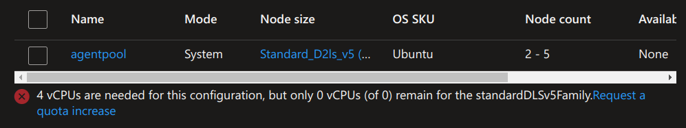

# 04 - Azure Kubernetes Services

<!-- *Nincs frissítve 2026. őszi félévre!* -->

## Cél

A labor célja megismerni magát az AKS szolgáltatást és a legfontosabb kapcsolódó szolgáltatásokat (ACR), valamint az AKS alkalmazások telepítésének különböző módszereit.

## Előkövetelmények

A laborleírás cross-platform eszközöket használ.

- Korábbi laborok infrastruktúrájából: `docker`, `docker compose`, `helm`
    - Windows-on is [linux konténer módban](https://learn.microsoft.com/en-us/virtualization/windowscontainers/deploy-containers/set-up-linux-containers#run-your-first-linux-container) 
- Azure [hallgatói előfizetés](https://azure.microsoft.com/en-us/free/students)
- [Azure CLI](https://learn.microsoft.com/en-us/cli/azure/install-azure-cli) v2.86 vagy újabb
- Azure [kubelogin és kubectl](https://azure.github.io/kubelogin/install.html)
    - az `az aks install-cli` felülírhatja a korábban telepített `kubectl` binárist
- Docker Hub eléréshez Docker Hub fiók és [Personal Access Token](https://docs.docker.com/security/access-tokens/personal-access-tokens/). Elég neki a *Repo Public Read-only* jogosultság (access permission).


## Előkészület

A feladatok megoldása során ne felejtsd el követni a [beadási folyamatot](../../information/GitHub.md).

!!! danger "PR név"
    :exclamation: A beadásnál a pull request neve legyen: *hf4* :exclamation:

!!! danger "NEPTUN"
    :exclamation: A feladatokban a `neptun` kifejezés helyett a saját neptunkódunkat helyettesítsük be minden esetben :exclamation:

## 0. Feladat

### Azure portál ajánlott beállítások

1. Lépjünk be az [Azure portálra](https://portal.azure.com).

2. Jobb felül nyissuk meg a beállításokat (fogaskerék ikon).

3. Állítsuk a [nyelvi beállításokat](https://learn.microsoft.com/en-us/azure/azure-portal/set-preferences#language--region) (felülről a harmadik menüpont). A nyelv legyen angol, a régiós formátum legyen magyar. Az **Apply** gombbal alkalmazzuk a beállításokat.

4. Visszatérve a portál beállításokhoz, nyissuk meg a [tenantjaink listáját](https://learn.microsoft.com/en-us/azure/azure-portal/set-preferences#directories--subscriptions) (felülről az első menüpont, *Directories + subscriptions*). Ellenőrizzük a táblázatban, hogy a BME tenant-e az aktív (*Current*) tenantunk. Ha nem, a **Switch** gombbal váltsunk át rá.

### Azure előfizetés ellenőrzése

1. Nyissuk meg az [előfizetések listáját](https://learn.microsoft.com/en-us/azure/azure-portal/get-subscription-tenant-id#find-your-azure-subscription): a keresőben vagy a bal oldali menüben keressük ki a *Subscriptions* oldalt és nyissuk meg.

2. Több előfizetést is láthatunk egy táblázatban, a hallgatói előfizetésünk *Azure for Students* néven jön létre és a szerepkörünk (*My role*) *Account admin* vagy *Owner*. Nyissuk meg a hallgatói előfizetésünket.

3. Az áttekintő oldalról (*Overview*) az előfizetés azonosítóját (*Subscription ID*) érdemes elmenteni, mert gyakran lesz rá szükség.

4. A hallgatói kreditünket az Azure portálon belül, az [*Education* (Azure Education Hub) oldalon követhetjük](https://learn.microsoft.com/en-us/azure/education-hub/navigate-costs#track-your-usage-in-the-education-hub): a keresőben keressük ki az *Education* oldalt és nyissuk meg. Az *Overview* oldalon ellenőrizzük, hogy megvan-e a 100$-nyi kreditünk. Itt látható a havi és az összesített fogyasztás, illetve az is, hogy mennyi idő van hátra a következő megújításig (a kredit egy évig használható fel, és aktív hallgatói státusz mellett évente megújítható).

5. A *View cost details* linkkel átjutunk a *Cost Management* oldalra, ahol szolgáltatásonként részletesebben is megnézhetjük, mi mennyit fogyasztott.

!!! tip "Költségkeret (budget)"
    A *Cost Management* oldalon [költségkeretet (budget) is beállíthatunk](https://learn.microsoft.com/en-us/azure/cost-management-billing/costs/tutorial-acm-create-budgets) az előfizetésre, ami e-mailben figyelmeztet, ha a költéseink elérnek egy általunk megadott határt. Érdemes beállítani, hogy a kredit ne fogyjon el észrevétlenül.


!!! warning "Azure költségek"
    Ha költséges erőforrásokat hoztunk létre, akkor különösen fontos rendszeresen ellenőrizni a maradék keretünket.

### Azure CLI ellenőrzése

1. Ellenőrizzük a verziószám(ok) kiírásával, hogy az Azure CLI elérhető-e.
    ```bash
    az version
    ```

2. Parancssorból [csatlakozzunk az Azure előfizetésünkhöz](https://learn.microsoft.com/en-us/cli/azure/authenticate-azure-cli-interactively). Csatlakozáskor listázódnak az előfizetések, válasszuk a hallgatói előfizetést.
    ```bash
    az login
    ```
   
    !!! tip "Aktuális előfizetés az Azure CLI-ben"
        Az Azure CLI parancsok általában nem kérik be az előfizetés azonosítóját, hanem egy globális beállításból veszik, ami belépéskor (`az login`) is beállítódik. Fontos, hogy mindig a megfelelő előfizetés legyen beállítva. Az `az account set -s <előfizetés azonosító>` paranccsal tudunk előfizetést váltani.

!!! danger "Közös Azure régió"
    Fontos, hogy minden Azure erőforrás lehetőleg azonos régióban legyen. A hallgatói előfizetésen egy házirend (policy) leszűkíti, hogy milyen régiókat használhatunk, ezért a közös régiót ezek közül kell kiválasztani. Az érvényesített házirendeket az Azure portálon lehet [listázni](https://portal.azure.com/#view/Microsoft_Azure_Policy/PolicyMenuBlade.MenuView/~/Assignments): az *Allowed resource deployment regions* nevű házirend `listOfAllowedLocations` nevű paramétere tartalmazza az engedélyezett régiók listáját. Ebből a listából válassz egy európai régiót, lehetőleg az alábbi tippben ajánlottak közül (pl. *Belgium Central* vagy *Spain Central*). Az erőforrásaid ezután mind ebben az egy régióban legyenek.

!!! tip "További ajánlott európai régiók"
    Bár ez dinamikusan változó, jelenleg (2026. október) egy hallgatói előfizetésen az alábbi európai régiókban érhető el az AKS-hez szükséges, a kvótába beleférő 2 magos VM kiméret:

    - D sorozatú (ajánlott) és B sorozatú kiméretek is: **Belgium Central** :flag_be:, **Spain Central** :flag_es:
    - B sorozatú kiméretek, és D sorozatból csak a kivezetés alatt álló (2028. májusig elérhető) D2_v2 / DS2_v2: **Austria East** :flag_at:. Ezekhez a régióban nincs publikált ár, így a havi költség előre nem látható (más régiókban kb. 100 $/VM/hó).
    - csak B sorozatú kiméretek: **Poland Central** :flag_pl:, **Sweden Central** :flag_se:

    Nem ajánlott, mert nincs használható 2 magos kiméret: North Europe, Italy North, Switzerland North, Germany West Central, France Central, Norway East, UK South, UK West. A West Europe-ban is csak két B sorozatú kiméret használható, ráadásul itt gyakran korlátozzák az ingyenes AKS létrehozását.

### Erőforráscsoport létrehozása

Hozz létre új erőforráscsoportot [ezen útmutatót követve](https://learn.microsoft.com/en-us/azure/azure-resource-manager/management/manage-resource-groups-portal#create-resource-groups) a hallgatói előfizetés alá *viaumb11* néven a közös Azure régióban (lásd fentebb).

!!! danger "Alapértelmezett Azure erőforráscsoport"
    A továbbiakban ezt az erőforráscsoportot add meg minden Azure erőforrás létrehozásakor.

## 1. Feladat

### AKS bevezető - mintaalkalmazás helyi kipróbálása

A labor során a hivatalos AKS bevezető gyakorlatot követjük némi módosítással. Az [első rész](https://learn.microsoft.com/en-us/azure/aks/tutorial-kubernetes-prepare-app?tabs=azure-cli) egy példaalkalmazást mutat be.

Kövesd az útmutatót a lokális tesztelési szakasz (*Test application locally*) végéig. Ez a rész a korábbi gyakorlatokon megismert `docker` és `docker compose` parancsokat használja. A Docker Compose -> Kubernetes manifest migrációs rész már nem kell.

### Azure Container Registry létrehozása

A hivatalos útmutató [második része](https://learn.microsoft.com/en-us/azure/aks/tutorial-kubernetes-prepare-acr?tabs=azure-cli) egy Azure Container Registry konténer tároló Azure CLI-ből történő létrehozásáról és feltöltéséről szól. Kezdő Azure használóknak inkább az Azure portál ajánlott, mert ott szemléletesebben látszódik minden beállítás. Emiatt inkább az [Azure portálos útmutatót](https://learn.microsoft.com/en-us/azure/container-registry/container-registry-get-started-portal?tabs=azure-cli#create-a-container-registry) kövesd, az alábbi beállításokkal:

- Name: *acr* előtag + neptun kód (pl. *npt123* neptun kód esetén *acrnpt123*)
- Resource group: az alapértelmezett Azure erőforráscsoport (lásd fentebb)
- Location: közös Azure régió (lásd fentebb)
- Domain name label scope: Unsecure
- Pricing plan / SKU: Basic
- Role assignment permission mode: RBAC Registry Permissions

Azure CLI-vel (`az acr login`) [regisztráljuk is az ACR-t a docker környezetünkbe](https://learn.microsoft.com/en-us/cli/azure/acr?view=azure-cli-latest#az-acr-login) tárolóként.

!!! warning "Lejáró bejelentkezés"
    Az `az acr login` által kapott token [csak 3 óráig érvényes](https://learn.microsoft.com/en-us/azure/container-registry/container-registry-authentication#individual-login-with-microsoft-entra-id). Ha később (pl. a 2. feladatban) a `docker push` `unauthorized: authentication required` vagy hasonló hibával meghiúsul, egyszerűen futtassuk le újra az `az acr login` parancsot.

### Konténerek feltöltése ACR-be

A hivatalos útmutató [második része](https://learn.microsoft.com/en-us/azure/aks/tutorial-kubernetes-prepare-acr?tabs=azure-cli) az ACR build szolgáltatását használja, amivel könnyen lehetne a fejlesztői gép erőforrásait kímélve a lemezképeket megépíteni. Az építéshez szükséges kontextust (forráskód, YAML) tölti csak fel, a kiinduló lemezkép és az építési folyamat is az ACR-en belül történik. Sajnos ez a szolgáltatás [jelenleg csak fizetős Azure előfizetésekben érhető el](https://learn.microsoft.com/en-us/azure/container-registry/container-registry-tasks-overview), hallgatóiban nem. Szerencsére az első feladatrész során a lemezképek elkészültek, így [azokat feltölthetjük](https://docs.docker.com/get-started/docker-concepts/building-images/build-tag-and-publish-an-image/).

!!! warning "Lemezkép architektúrák"
    A lemezkép CPU architektúrájának [kompatibilisnak kell lennie](https://docs.docker.com/build/building/multi-platform/#why-multi-platform-builds) a Docker környezet CPU architektúrájával (AKS esetén ez alapesetben: `linux/amd64`). Linuxos és Windows-os fejlesztői környezetben is általában linuxos Docker környezetet használunk, így általában nem lesz ebből gondunk (`docker image inspect <lemezkép név vagy id>` paranccsal ellenőrizhetjük: az *Architecture* tulajdonságot figyeljük). Viszont például ARM64 CPU-s Mac esetében gond lehet, a fejlesztői gépen készített lemezkép AKS-en nem fog jól működni. Ilyenkor a legegyszerűbb linuxos lemezképet készíttetni az AKS számára, amit például a `DOCKER_DEFAULT_PLATFORM` [környezeti változó beállításával tehetünk meg](https://stackoverflow.com/questions/65612411/forcing-docker-to-use-linux-amd64-platform-by-default-on-macos). Az így készült lemezkép csak egy platformot támogat. Többplatformos lemezképet is [készíthetünk](https://docs.docker.com/build/building/multi-platform/#build-multi-platform-images) a *buildx* docker CLI plugin-nal, így ugyanaz a lemezkép több architektúrán is használható.

1. Tag-eljük meg az alábbi három *aks-store-demo* lemezképet. Az $ACRNAME helyére helyettesítsük be az ACR-ünk nevét (*acr+neptun kód*).

    ```bash
    docker tag aks-store-demo-product-service "$ACRNAME.azurecr.io/aks-store-demo/product-service:2.2.0"
    docker tag aks-store-demo-store-front "$ACRNAME.azurecr.io/aks-store-demo/store-front:2.2.0"
    docker tag aks-store-demo-order-service "$ACRNAME.azurecr.io/aks-store-demo/order-service:2.2.0"
    ```

    !!! warning "Lemezkép verziók"
        Ellenőrizd, hogy a lemezkép verziója megegyezik-e a K8s yaml leírókban (aks-store-quickstart.yaml, aks-store-all-in-one.yaml) elvárt verziószámokkal. Ha nem, módosítsd a fenti parancsokban a verzió tag-eket.

2. Töltsük fel a képeket.

    ```bash
    docker push "$ACRNAME.azurecr.io/aks-store-demo/store-front:2.2.0"
    docker push "$ACRNAME.azurecr.io/aks-store-demo/order-service:2.2.0"
    docker push "$ACRNAME.azurecr.io/aks-store-demo/product-service:2.2.0"
    ```
   
    !!! tip "ACR által használt tárhely"
        Az ACR Azure portálos oldalán belül a *Metrics* menüpontban a *Storage used* nevű [metrikát](https://learn.microsoft.com/en-us/azure/container-registry/monitor-container-registry-reference#supported-metrics-for-microsoftcontainerregistryregistries) kiválasztva ellenőrizhetjük az ACR által használt tárhelyet, illetve annak időbeli változását. Másik lehetőség az *Overview* menüponton belül a *Monitoring* alfül.


    Az útmutató nem tér ki rá, de a teljesség kedvéért foglalkozzunk még további lemezképekkel. AKS-be az [aks-store-quickstart.yaml](https://github.com/Azure-Samples/aks-store-demo/blob/main/aks-store-quickstart.yaml)-t fogjuk majd telepíteni, ami a fentieken túl a [busybox](https://hub.docker.com/_/busybox) lemezképet is használja a Docker Hub-ról. Bár technikailag az AKS be tudja szerezni ezt a lemezképet a Docker Hub-ról, ezt is tegyük elérhetővé a saját ACR-ünkben.

    !!! tip "Kitekintés - külső források"
        Nagyvállalati környezetben a külső források elérése gyakran tiltott (pl. tűzfalszabályokkal), ezen források biztonsági és egyéb szempontok miatt alapértelmezetten megbízhatatlannak számítanak. A docker alapértelmezett forrása, a Docker Hub például korlátozásokat (rate limiting) [vezetett be](https://medium.com/@alaa.barqawi/docker-rate-limit-with-azure-container-instance-and-aks-4449cede66dd) az AKS-es letöltésekre is. Mindezek miatt a nagyvállalati klaszterek csak belső céges repository-kat használhatnak, amiket egy dedikált csapat kezel: megfelelő ellenőrzés után emelnek be külső vagy belső fejlesztésű elemeket (artifaktokat). Emiatt fontos, hogy minden telepítési egység (pl. helm chart) paraméterezhető legyen a függőségeinek elérhetősége kapcsán.

3. Az ACR képes átemelni külső forrásból lemezképeket, ha hálózatilag eléri és a külső forrás hozzáférésszabályozásán is át tud jutni. A Docker Hub esetében ez nem túl bonyolult, csak egyetlen Azure CLI parancs ([az acr import](https://learn.microsoft.com/en-us/azure/container-registry/container-registry-import-images?tabs=azure-cli#import-container-images-from-docker-hub)). Felhasználónévként a Docker Hub felhasználónevünket adjuk meg, jelszóként pedig a felhasználónkhoz tartozó egyik Personal Access Token-ünket.

    ```bash
    az acr import --name $ACRNAME --source docker.io/library/busybox:1.37.0 --image busybox:1.37.0 --force --username $DOCKERHUB_USER --password "$DOCKERHUB_TOKEN"
    ```

4. Másik extra lemezkép a [rabbitmq](https://hub.docker.com/_/rabbitmq) `4.3.2-management-alpine` verziója, ez is a Docker Hub-ról származik. Ezt is importáljuk hasonlóan.

    ```bash
    az acr import --name $ACRNAME --source docker.io/library/rabbitmq:4.3.2-management-alpine --image rabbitmq:4.3.2-management-alpine --force --username $DOCKERHUB_USER --password "$DOCKERHUB_TOKEN"
    ```

5. Ellenőrizzük a feltöltött lemezképeket az Azure portálon, az ACR [Repositories menüpontjában](https://learn.microsoft.com/en-us/azure/container-registry/container-registry-get-started-portal?tabs=azure-cli#list-container-images).

### AKS létrehozása, méretezése

Azure-ban minden erőforrás létrehozás, kezelés, stb. REST API-k segítségével történik, ezeket az API-kat ún. *resource provider*-ek ajánlják ki. Egy adott szolgáltatásnak általában saját resource providere van, de nem mindegyik van alapból bekapcsolva egy adott előfizetésen. Előfizetés-tulajdonosként ezzel általában nem kell foglalkoznunk, egy szolgáltatás létrehozásakor a kapcsolódó resource provider automatikusan bekapcsolódik. Néhány esetben mégis szükség lehet arra, hogy kézzel kapcsoljunk be (regisztráljunk) provider-eket. Ilyen eset lehet, ha AKS létrehozás **előtt** a portál vCPU kvótákat ellenőriz - mint mindenhez, ehhez is API-t kell hívni. Ezért az AKS létrehozása előtt [ezen útmutató](https://learn.microsoft.com/en-us/azure/azure-resource-manager/management/resource-providers-and-types#register-resource-provider-1) alapján ellenőrizzük, hogy a *Microsoft.Compute* provider regisztrálva van-e. Ha nincs, regisztráljuk.

A hivatalos útmutató [harmadik része](https://learn.microsoft.com/en-us/azure/aks/tutorial-kubernetes-deploy-cluster?tabs=azure-cli) az AKS-t Azure CLI-vel hozza létre. Helyette kövesd [az Azure portálos utat](https://learn.microsoft.com/en-us/azure/aks/learn/quick-kubernetes-deploy-portal?tabs=azure-cli) a következő általános beállításokkal:

- Name: *aks* előtag + neptun kód (pl. *npt123* neptun kód esetén *aksnpt123*)
- Resource group: az alapértelmezett Azure erőforráscsoport (lásd fentebb)
- Cluster preset configuration: Dev/Test
- Region: közös Azure régió (lásd fentebb)
- Authentication and Authorization: Microsoft Entra ID authentication with Azure RBAC

A *Node Pool* fülön kell méreteznünk a klasztert. Ez hallgatói előfizetés esetén nem egyszerű, mert csak bizonyos virtuális gép típusok érhetőek el, azok is csak kis számban. Ráadásul a kínálat időben és régiók mentén folyamatosan változik. Az aktuális kínálat az [Azure portálon](https://learn.microsoft.com/en-us/azure/quotas/view-quotas) követhető.

!!! warning "Kvóta növelése - elméletben"
    Számos kvóta elvileg a portálon keresztül is [növelhető](https://learn.microsoft.com/en-us/azure/quotas/per-vm-quota-requests), de ez hallgatói előfizetés esetében általában nem működik.

!!! danger "User node pool"
    Semmiképp ne adjunk a klaszterhez **user** node poolt, mert akkor a skálázásra végképp nem marad kvótánk. Csak a system node poolba vegyünk olcsóbb, max. 2 magos virtuális gépeket.

Első körben próbáljuk a portál által felajánlott géptípussal a létrehozást. Ha ezzel sikerül, akkor nézzünk utána a gépcsalád [árazásának](https://azure.microsoft.com/en-us/pricing/details/virtual-machines/linux/). Ha nem sikerül, akkor az alábbiak szerint próbálkozzunk. Segítségképpen lefuttathatjuk az [aks-sku-check.cs](aks-sku-check.cs) scriptet, ami előszűri a gépcsaládokat az előfizetésünk és az AKS korlátai mentén.

A system node pool méretezésekor érdemes a *Choose a size* opció által feldobott felületen a pontosan 2 magos (lehet rá szűrni), legalább 4 GB memóriájú kiméretek közül próbálkozni. Elsősorban a *D* betűvel kezdődő kódú kiméreteket (pl. D2as_v4, D2s_v4) válasszuk: ezek folyamatosan teljes CPU teljesítményt adnak és 8 GB memóriájúak. Ha ezekhez nincs kvótánk, tartalékként a B sorozat v2 generációjának 4 GB-os tagjai (B2als_v2, B2ls_v2) is megfelelnek. Ezek olcsóbbak (kb. 30 EUR/VM havonta), de ún. burstable kiméretek: tartós terhelés alatt a CPU teljesítményük visszafogásra kerül, ami a terheléses mérések eredményeit torzíthatja, és a 4 GB memória is szűkös lehet. A felület mutatja a havi költséget is (*Cost/month*): B sorozatnál a 30-40 EUR/VM, D sorozatnál a 60-90 EUR/VM költség már jónak számít.

!!! warning "System node pool szabályok"
    A kiválasztott kiméretnek az AKS [system node pool-ra vonatkozó minimum feltételeinek](https://learn.microsoft.com/en-us/azure/aks/use-system-pools?tabs=azure-cli#system-and-user-node-pools) is meg kell felelnie - elméletben. A dokumentáció szigorúbb szabályokat ír (min. 4 mag, B sorozat tiltása, min. 2 node), de a 2026. októberi állapot szerint az AKS ARM providere ténylegesen csak azt ellenőrzi, hogy a kiméret legalább 2 magos és legalább 4 GB memóriájú legyen. Így a 2 magos, 4 GB-os B sorozatú kiméretek (pl. *B2als_v2*) is használhatók, és az 1 node-os system node pool is működik. Ennél kisebb kiméret esetén a létrehozás `SystemPoolSkuTooLow` hibával meghiúsul. **Éles** környezetben mindig a dokumentált, támogatott konfigurációt vegyük alapul!

A VM kiméret választás után a *Node Pool* fülre visszatérve az Azure ellenőrzi a legtöbb szabályt. Ha nem látunk hibaüzenetet, akkor jó esélyeink vannak.

<figure markdown="span">
  
  <figcaption>Nincs meg ehhez a jóárasított VM kimérethez a szükséges kvótánk</figcaption>
</figure>

!!! danger "Free AKS korlátozás"
    A legnagyobb terhelésnek kitett Azure régiókban (pl. *West Europe*) előfordulhat, hogy korlátozzák az ingyenes (csak a neve ingyenes!) csomagú AKS-ek létrehozását.

Az *Integrations* fülön válasszuk ki az ACR-ünket.

A többi fülön hagyjuk meg az alapértelmezett értékeket. 

1. Indítsuk el a létrehozási folyamatot.  

2. A létrehozás végeztével (10-15 perc is lehet!) [fedezzük fel a klaszter logikai szerkezetét az Azure portálon keresztül](https://learn.microsoft.com/en-us/azure/aks/kubernetes-portal?tabs=azure-cli#view-kubernetes-resources). 

3. Ellenőrizzük, hogy tudunk-e csatlakozni a kubectl eszközünkkel. Erre a legkényelmesebb mód, ha az AKS-ünk Azure Portal oldalának *Overview* menüpontját megnyitva, a vízszintes menüben a *Connect* gombot megnyomva, [az előre elkészített parancsokat használjuk](https://learn.microsoft.com/en-us/azure/aks/kubernetes-portal?tabs=azure-cli#connect-to-your-aks-cluster). Futtassunk le egy-két lekérdező `kubectl` parancsot.

4. Kukkantsuk meg a klasztert alkotó Azure infrastruktúraszolgáltatásokat: a *Properties* menüpontban az *Infrastructure resource group* linkre kattintva átugorhatunk az ezen szolgáltatásokat összefogó erőforráscsoportba.

Az útmutató negyedik része az AKS-specifikus tárhely konfigurációval foglalkozik, de erre most nincs szükségünk, így kihagyjuk.

### Mintaalkalmazás telepítése

A hivatalos útmutató [ötödik része](https://learn.microsoft.com/en-us/azure/aks/tutorial-kubernetes-deploy-application?tabs=azure-cli) alapján telepítsük a mintaalkalmazást. Az ACR login szerver és a K8s service külső IP címe is megszerezhető az Azure portálról. Az útmutató rész végére érve **ne** töröljük a telepítést.

!!! warning "Lemezkép verziók"
    A K8s leíróban elvileg csak a lemezkép nevének elejét kell átírni, hogy tartalmazza az ACR-ünk nevét, a verzió tagnek meg kell egyeznie az ACR-be feltöltött lemezkép verziójával. Ha a korábbi feladatban leírtak szerint ezt már közös nevezőre hoztad, akkor itt már nem kell a verziókat átírni.

!!! warning "K8s erőforráskorlátok"
    A mintaalkalmazás korábbi verziójában némely konténer [erőforráslimitje](https://kubernetes.io/docs/concepts/configuration/manage-resources-containers/) nagyon alacsony volt (pl. 10 MB memória), amit igen könnyű volt átlépni és ilyenkor az ütemező folyamatosan ki-kilőtte a podot (hibaüzenet valami hasonló volt: *container init was OOM-killed (memory limit too low?)*), a ráépülő szolgáltatás nem tudott rendben működni. Az aktuális verzióban ezt már [javították](https://github.com/Azure-Samples/aks-store-demo/commit/afe11f4ca94a154f43c3b72187b8684c048e608b#diff-46a7464f533643281cbe9a01070701f8acfc30f993f74ece069958ef3e3c4767R191) a *product-service* konténer esetében. Ha hasonló hibajelenséget észleltek, akár a helyi K8s-ben, akár AKS-ben, nyugodtan állítsátok a hibát jelző konténer limitjét a YAML-ben.

!!! example "BEADANDÓ"
    Készíts egy képernyőképet (`f1.png`) és commitold azt be a házi feladat repó gyökerébe, amin látszik:

    - a futó alkalmazás böngészőben, böngésző címsorban az alkalmazás (IP) címével
    - parancssorban a kapcsolódó K8s *service* adatai (`kubectl get service store-front`)
    - parancssorban az alkalmazás K8s *deployment* erőforrásai a lemezképek azonosítóival együtt (`kubectl get deployment -o wide`).

    Commitold be a végleges aks-store-quickstart.yaml-t is.

## 2. Feladat

Az _AKS store demo_ teljesebb változatát - hasonlót ahhoz, ami a K8s háziban is szerepelt -, telepítsük ugyanebbe az AKS-be, egy külön [kubernetes névtérbe](https://kubernetes.io/docs/concepts/overview/working-with-objects/namespaces/).

### 2.1 Névtér létrehozása

Ez egyszerű:

```bash
kubectl create namespace "fullstore-$neptun"
```

### 2.2 Extra lemezképek

A teljesebb változatot az [aks-store-all-in-one.yaml](https://github.com/Azure-Samples/aks-store-demo/blob/main/aks-store-all-in-one.yaml) alapján tervezzük telepíteni. Ez hivatkozik pár extra lemezképre, melyek egy részét meg kell építenünk. Erre egyik lehetőség a [nagyobbik Docker Compose file használata](https://github.com/Azure-Samples/aks-store-demo/blob/main/docker-compose.yml), például a `docker compose -f docker-compose.yml build` paranccsal (csak építeni akarunk, nem futtatni).

Ezeket a lemezképeket újraépíti ugyan a `docker compose build`, de már fel vannak töltve ACR-be:

- store-front
- order-service
- product-service

Ezeket is megépíti, de még nincsenek feltöltve. Taggeljük megfelelő ACR névvel és verzióval (az aks-store-all-in-one.yaml-nak megfelelően) és töltsük fel ACR-be:

- makeline-service
- store-admin

A külső lemezképek közül még ezekre épít a K8s leíró - importáljuk az eddig nem importálta(ka)t ACR-be:

- busybox - ez már megvan korábbról
- rabbitmq - ez is már megvan korábbról
- documentdb-local - a GHCR-ből (ghcr.io/documentdb/documentdb/documentdb-local:pg17-0.112.0)

!!! warning "GHCR hitelesítés"
    Importnál ne használjuk a *Docker Hub* felhasználónevet és jelszót, ha az importálandó nem egy Docker Hub-os image, hanem pl. GitHub-os (ghcr.io). Próbáljuk felhasználónév és jelszó nélkül importálni. Végszükség esetén (rate limiting hiba) **GitHub** felhasználónevet és tokent lehet használni.

### 2.3 Lemezképek hivatkozása

1. Töröljük a `virtual-customer` és `virtual-worker` deployment-eket a K8s leíróból.

2. Nézzük át a megmaradt YAML fájlt, az `image:` sorokat írjuk át, hogy mindenhol a saját ACR-ünkre hivatkozzon - hasonlóan az 1-es feladathoz. Figyeljünk rá, hogy az ACR-en belüli elérési útvonal is megfelelő legyen. Az ACR Azure portálos felületén meg tudjuk nézni az egyes lemezképek teljes nevét (_Artifact reference_ vagy _Docker pull command_), ha kiválasztunk egy lemezkép verziót. A legbiztosabb, ha innen másoljuk ki.

    

### 2.4 Traefik

A YAML leíró _ClusterIP_ és _LoadBalancer_ service típusokat használ, ez utóbbi azt okozza, hogy egy publikus IP címen lesz kívülről is [elérhető](https://learn.microsoft.com/en-us/azure/aks/load-balancer-standard#create-a-load-balancer-service-in-aks) az adott szolgáltatás. Mivel minden szolgáltatás külön IP-t kap, így nagyon gyorsan kifuthatunk a (régiónkénti) [publikus IP cím kvótánkból](https://learn.microsoft.com/en-us/azure/quotas/networking-quota-requests).

Jobb lenne egy korábban már látott Traefik proxy jellegű megoldás, ahol egy proxy / ingress kontroller lenne az egyetlen kívülről elérhető belépési pont és a proxy valamilyen címzési módszerrel (routing) különítené el a különböző webalkalmazásokat. Tipikus címzési módszerek, amik az URL különböző részei alapján irányítják a kérést:

- az URL _path_ része alapján
- az URL _hostname_ része alapján
- az URL _port_ része alapján

A K8s háziban egy _path_ alapú megoldást valósítottunk meg, de ehhez előre [fel kellett készíteni](https://vite.dev/guide/build.html#public-base-path) a webalkalmazások kódját (a kiinduló projekt már fel volt készítve). A _hostname_ alapú általában transzparensebb a webalkalmazások szempontjából, egy előre konténerizált webalkalmazást lényegében bármilyen hosztnév alatt elérhetővé tehetünk. Publikus elérés esetén ehhez publikus DNS-be való bejegyzés szükséges. Szerencsére létezik egy úgynevezett _zero config_ DNS szolgáltatás is, a [nip.io / sslip.io](https://nip.io): a nip.io és az sslip.io domain-ek ma már egyazon szolgáltatáshoz tartoznak, felcserélhetők. A szolgáltatás bármely IP címhez konfiguráció nélkül, automatikusan rendel hosztnevet. Például a `20.30.40.50` publikus IP címhez a `store-front.20.30.40.50.nip.io` (vagy az egyenértékű, kötőjeles `store-front-20-30-40-50.nip.io`, vagy ugyanez `.sslip.io` végződéssel) hosztnév tartozik. Így a _hostname_ alapú megoldás lesz a legmegfelelőbb választás: nem kell a webalkalmazások kódját módosítani, és a DNS-sel sem kell foglalkozni. A _port_ alapú megoldás egyetlen publikus IP címen, külön portokon tenné elérhetővé az alkalmazásokat, így spórolna a publikus IP címekkel. Cserébe a felhasználóknak a portszámot is meg kellene adniuk az URL-ben (pl. `http://20.30.40.50:8090`), ami nem túl felhasználóbarát egy megfelelően szép domain névhez képest.

!!! warning "Zero config DNS éles környezetben"
    A nip.io / sslip.io egy ingyenes szolgáltatás, amelyhez nem tartozik rendelkezésre állási garancia (SLA), és amelynek elérhetősége vagy feltételei bármikor változhatnak. Ráadásul a hosztnevek magukba foglalják a publikus IP címet, így annak változásakor (pl. a load balancer újralétrehozása után) a hosztnevek is megváltoznak. Éles (production) környezetben ezért **ne használjunk zero config DNS-t** - ott saját domain és saját DNS zóna (vagy egy megbízható DNS szolgáltató) szükséges.

A Traefik proxy támogatja a hostname alapú routing-ot is, ezért ismét Traefik-et használunk. Telepítsük a Traefik-et is az ACR-ünkből. Cél, hogy a store-front és a store-admin is ugyanazon az AKS load balancer publikus IP címen, a szabványos 80-as (HTTP) porton legyen elérhető, a bejövő kérések hosztneve alapján szétválasztva.

1. Importáljuk a Traefik helm chart-ot és a Traefik lemezképet is az ACR-be. A helm chart csak a telepítési leírókat tartalmazza, a Traefik lemezkép alapértelmezetten a Docker Hub-ról töltődne le. A lemezkép verziója a chart `appVersion` értékét követi (`helm show chart` paranccsal ellenőrizhető), a 42.1.2-es chart esetén ez `v3.7.16`.

    ```bash
    az acr import --name $ACRNAME --source ghcr.io/traefik/helm/traefik:42.1.2 --image helm/traefik:42.1.2
    az acr import --name $ACRNAME --source docker.io/library/traefik:v3.7.16 --image traefik:v3.7.16 --force --username $DOCKERHUB_USER --password "$DOCKERHUB_TOKEN"
    ```

2. A [telepítési beállításokat](https://github.com/traefik/traefik-helm-chart/blob/master/EXAMPLES.md) most közvetlenül a parancssorban, `--set` kapcsolókkal adjuk meg, külön values fájl nélkül. Két beállítást módosítunk: engedélyezzük a Traefik dashboard-ot (`ingressRoute.dashboard.enabled=true`), és a Traefik lemezképet az ACR-ünkből töltetjük le (`image.registry=$ACRNAME.azurecr.io`). A lemezkép neve (`traefik`) és verziója (a chart `appVersion` értéke) megegyezik az importálttal, így ezeket nem kell megadnunk.

    Itt csak a Traefik dashboard-ot tesszük elérhetővé - [legalábbis kubectl port-forward-on keresztüli elérésre](https://github.com/traefik/traefik-helm-chart/blob/master/EXAMPLES.md#access-traefik-dashboard-without-exposing-it). Mivel mindkét webalkalmazás a szabványos 80-as porton, a Traefik alapértelmezett `web` entrypointján keresztül lesz elérhető, külön extra port definiálására nincs szükség.

3. Telepítsük a Traefik-et ACR-ből. Ehhez előbb a helm-nek azonosítania kell magát az ACR felé. Ez szerencsére nem gond, ha van [Azure CLI-nk](https://learn.microsoft.com/en-us/azure/container-registry/container-registry-helm-repos#authenticate-with-the-registry).

    ```bash
    az acr login --name $ACRNAME --expose-token --output tsv --query accessToken | helm registry login "$ACRNAME.azurecr.io" --username "00000000-0000-0000-0000-000000000000" --password-stdin
    helm install traefik "oci://$ACRNAME.azurecr.io/helm/traefik" --version 42.1.2 --namespace "fullstore-$neptun" --set ingressRoute.dashboard.enabled=true --set image.registry="$ACRNAME.azurecr.io"
    ```

    !!! warning "kubectl context"
        A helm a telepítési célként a kubectl aktív kontextjét használja. Ügyeljünk arra, hogy az AKS-ünk legyen az aktív kontext.

4. Ellenőrizzük, hogy megjelent-e a _traefik_ nevű K8s service, és kérdezzük le a publikus IP címét az előző feladatban megismert módszerrel. Jegyezzük fel a címet, a következő alfejezetben a hosztnevek képzéséhez lesz rá szükség. Ellenőrizzük azt is, hogy a Traefik már az ACR-ből származó lemezképet használja (`kubectl get deployment traefik -n "fullstore-$neptun" -o wide`).

### 2.5 Gateway API

A korábbi háziban Ingress API-t használtunk, itt most kipróbáljuk az utódját, a Gateway API-t. Ez egy modernebb, szerepkörökre bontott (role-oriented) megközelítést kínál: külön erőforrások definiálják a klaszter belépési pontját (_Gateway_), az útválasztási szabályokat (_HTTPRoute_) és a hálózati házirendeket. A Traefik natívan támogatja a Gateway API-t, így ezt használjuk a hosztnév alapú routinghoz.

1. A Gateway API használatához először telepítenünk kell a [Gateway API CRD-ket](https://gateway-api.sigs.k8s.io/guides/#installing-gateway-api) a klaszterbe, mert azok alapértelmezetten nincsenek telepítve:

    ```bash
    kubectl apply -f https://github.com/kubernetes-sigs/gateway-api/releases/download/v1.6.3/standard-install.yaml
    ```

2. Ezután engedélyezzük a Traefik számára a Gateway API erőforrások figyelését (`providers.kubernetesGateway.enabled=true`). Frissítsük a Traefik telepítést az új beállítással:

    ```bash
    helm upgrade traefik "oci://$ACRNAME.azurecr.io/helm/traefik" --version 42.1.2 --namespace "fullstore-$neptun" --set ingressRoute.dashboard.enabled=true --set image.registry="$ACRNAME.azurecr.io" --set providers.kubernetesGateway.enabled=true
    ```

    !!! warning "Korábbi beállítások megismétlése"
        A `helm upgrade` alapértelmezetten **nem** őrzi meg a korábban `--set` kapcsolókkal megadott értékeket: a chart alapértelmezett értékeiből és csak az aktuális parancsban megadott beállításokból indul ki. Ezért a korábbi beállításokat (`ingressRoute.dashboard.enabled`, `image.registry`) is meg kell ismételni, különben visszaállnak az alapértelmezett értékükre: eltűnik a dashboard, és a Traefik lemezkép ismét a Docker Hub-ról töltődik le.

    !!! info "Gateway API CRD verzió figyelmeztetés"
        A `helm upgrade` kimenetében megjelenhet egy `DEPRECATION WARNING`, ami a Gateway API CRD-k egy régebbi (pl. v1.5.1) verziójának telepítését javasolja. Ezt figyelmen kívül hagyhatjuk: a fentebb telepített újabb (v1.6.3) CRD-k is megfelelnek, a Traefik ezekkel is rendben működik. A figyelmeztetés lényege csak annyi, hogy a chart egy jövőbeli főverziója már nem fogja magával hozni a CRD-ket, azokat - ahogy mi is tettük - külön kell telepíteni.

    A Traefik automatikusan létrehoz egy `traefik` nevű _GatewayClass_ erőforrást, ami a Traefik kontrollerhez tartozó belépési pontokat definiálja. Ellenőrizzük:

    ```bash
    kubectl get gatewayclass
    ```

    A helm chart ezen kívül egy alapértelmezett _Gateway_ erőforrást is létrehoz `traefik-gateway` néven, a Traefik telepítési névterében - a chart `gateway.enabled` alapértelmezett `true` beállítása miatt. Ez a _Gateway_ a Traefik alapértelmezett `web` entrypointjának megfelelő listenert definiál: `web` néven, HTTP protokollal, a 8000-es porton. (A Gateway API-ban a listener portja a Traefik podon belüli entrypoint portjára utal; a `traefik` _LoadBalancer_ szolgáltatás a külső, szabványos 80-as portot képezi le erre a belső portra.) Ellenőrizzük ezt is:

    ```bash
    kubectl get gateway traefik-gateway -n "fullstore-$neptun" -o yaml
    ```

3. Állítsuk az *aks-store-all-in-one.yaml*-ben minden K8s service típusát `ClusterIP`-re. Csak a Traefik szolgáltatás lesz kívülről elérhető (_LoadBalancer_ típus), de az nem ebben a YAML-ben van definiálva, hanem a Traefik helm chart kezeli.

4. Adjunk hozzá a YAML fájlhoz egy _HTTPRoute_ erőforrást.

    Az alábbi _HTTPRoute_ a hosztnév alapján irányítja a kérést a *store-front* szolgáltatáshoz, a `parentRefs` mezőben a fenti, Traefik által létrehozott `traefik-gateway` _Gateway_-re hivatkozva (a `sectionName` mező a _Gateway_ `web` nevű listenerét választja ki). A hosztneveket a 2.4-es lépésben megismert zero config DNS szolgáltatás (nip.io / sslip.io) alapján képezzük: a Traefik publikus IP címéből. Például ha a publikus IP cím `20.30.40.50`, akkor a két alkalmazáshoz tartozó hosztnevek `store-front-20-30-40-50.nip.io` és `store-admin-20-30-40-50.nip.io`.

    ```yaml
    # HTTPRoute a store-front alkalmazáshoz
    apiVersion: gateway.networking.k8s.io/v1
    kind: HTTPRoute
    metadata:
      name: store-front-route
    spec:
      parentRefs:
        # A fenti `kubectl get gateway traefik-gateway`
        # parancs kimenetében szereplő Gateway neve (metadata.name)
        - name: traefik-gateway
          # A Gateway `web` nevű listenerére hivatkozik (listeners[].name),
          # amely HTTP protokollt használ a 8000-es porton
          sectionName: web
      hostnames:
        # Módosítsd! A Traefik publikus IP címe alapján képzett hosztnév (nip.io zero-config DNS)
        - "store-front-20-30-40-50.nip.io"
      rules:
        - backendRefs:
            - name: store-front
              port: 80
    ```

    !!! info "Miért nincs _Gateway_ a saját YAML fájlunkban?"
        A `traefik-gateway` _Gateway_-t a Traefik helm chart hozza létre, ezért azt nem kell a saját YAML fájlunkban definiálnunk. Ha mégis ugyanezzel a névvel definiálnánk, akkor a `kubectl apply` figyelmeztetést írna ki (`resource gateways/traefik-gateway is missing the kubectl.kubernetes.io/last-applied-configuration annotation`), mert a helm által létrehozott erőforrás nem `kubectl apply` által jött létre; ráadásul a helm és a `kubectl apply` ezután egymással ütközne az erőforrás kezelésében.

5. Adjunk hozzá a YAML fájlhoz egy további _HTTPRoute_ erőforrást a fenti mintájára, ami a *store-admin* szolgáltatás felé irányít (domain prefix: store-admin).

6. Telepítsünk, azaz alkalmazzuk a YAML leírót. Mivel a leíró nem hivatkozik K8s névtérre, ezért azt az `apply` parancsban be tudjuk állítani, így minden erőforrás a megadott névtérbe kerül.

    ```bash
    kubectl apply -f aks-store-all-in-one.yaml -n "fullstore-$neptun"
    ```

7. Ellenőrizzük az Azure portálon vagy `kubectl` parancsokkal, hogy minden K8s objektum rendben elindult-e. Ellenőrizzük a Gateway API objektumokat is:

    ```bash
    kubectl get gateway,httproute -n "fullstore-$neptun"
    ```

    Ellenőrizzük, hogy a weboldalak a tervezett hosztneveken elérhetőek-e (például `http://store-front-20-30-40-50.nip.io` és `http://store-admin-20-30-40-50.nip.io`, a saját publikus IP címmel).

8. Teszteld le az alkalmazást, vidd végig a K8s házi 3. feladatának beadandójához is szükséges tesztlépéseket (termék átnevezés, rendelés feladás, rendelés teljesítés).

9. A K8s háziban megismert _port forward_ módszerrel tedd elérhetővé localhost-on a Traefik dashboard-ot.

    !!! warning "Traefik dashboard port"
        A dashboard alapértelmezésben a pod 8080-as belső portjára kerül; ez a port a `traefik` service-en nincs kivezetve, így a port forward célja a deployment vagy a pod legyen.

!!! example "BEADANDÓ"
    Készíts az alábbi tesztesetekről képernyőképeket, és commitold be a házi feladat repó gyökerébe:

    - Publikus oldal        
        - A *Proceed to checkout* gombra kattintva egy 1-10 db közötti véletlen mennyiségű, *neptun kódosra módosított nevű* termékre vonatkozó rendelés beküldésre került (sikeres üzenet). (`f2.1.1.png`)
    - Admin felület
        - A fenti rendelésen a *Complete Order* gombra kattintva az állapotmódosítás sikeres, a rendelés állapota *Completed*-re változik. (`f2.1.2.png`)        

    Készíts egy másik képernyőképet (`f2.2.png`) és commitold be ezt is a házi feladat repó gyökerébe, ahol az Azure portálon látszik az AKS infrastruktúra erőforráscsoportjának (MC_ kezdetű) áttekintő nézete (*Overview*). Látszódjon a portálra belépett felhasználó azonosítója a jobb felső sarokban.
    
    Készíts egy másik képernyőképet (`f2.3.png`) és commitold be ezt is a házi feladat repó gyökerébe, ahol a végállapotban látszanak parancssorban az új névtér K8s *deployment* erőforrásai a lemezképek azonosítóival együtt (`kubectl get deployment -n fullstore-neptun -o wide`)

    Készíts egy másik képernyőképet (`f2.4.png`) és commitold be ezt is a házi feladat repó gyökerébe, ahol a Traefik dashboard _HTTP Routers_ listája látható (pl. http://localhost:8080/dashboard/#/http/routers). 

    Commitold be a végleges *aks-store-all-in-one.yaml*-t is.

## 3. Feladat - talán a legfontosabb

!!! danger "AKS kikapcsolása, takarítása"
    Beadás után, ha nem egyből folytatod a következő házival, akkor [állítsd le az AKS-t](https://learn.microsoft.com/en-us/azure/aks/start-stop-cluster). Azure Portal-on is lehet, az AKS _Overview_ oldalán is ott a **Stop** gomb.

    A következő házihoz elég a `default` névtérbe telepített alkalmazás (1. feladat). Az ezt követően telepített K8s objektumok (`fullstore-neptun` névtér) törölhetőek.
    
    Ha egyáltalán nem adod be a következő házit, akkor törölj minden erőforráscsoportot.
