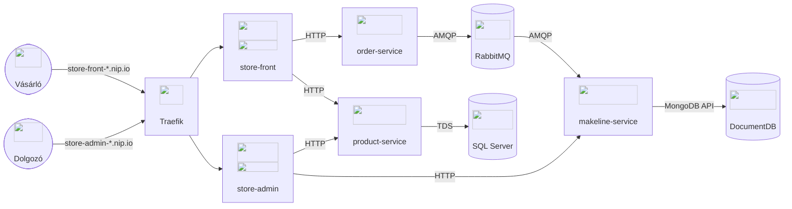

# Példa nagyházi-specifikáció

<!--
A példa az AKS Store Demo (https://github.com/Azure-Samples/aks-store-demo) architektúrájára épül.
Az eredeti mintából kihagytuk a terhelést szimuláló virtual-* szolgáltatásokat (virtual-customer, virtual-worker),
és kiegészítettük egy MS SQL Server adatbázissal, amelyben a product-service a termékeket tárolja.
Ez utóbbi eltér az eredeti mintától, ahol a product-service csak memóriában tartja a termékeket.
-->

## Követelményspecifikáció

Egy webáruházrendszert kell megvalósítani, amely lehetővé teszi a vásárlók számára, hogy termékeket rendeljenek, és az üzlet dolgozói számára, hogy kezeljék a rendelések feldolgozását és a termékek kezelését.

- A vásárlók böngészhetnek a termékek között
- A vásárlók termékeket adhatnak a kosarukhoz és leadhatják a rendeléseiket
- Az üzlet dolgozói megtekinthetik a sorban lévő rendelések listáját
- Az üzlet dolgozói megtekinthetik a rendelések részleteit és kezelhetik azok állapotát (Pending, Processing, Complete)
- Az üzlet dolgozói CRUD műveleteket végezhetnek a termékeken (létrehozás, megtekintés, módosítás, törlés)

## Architektúra és technológiák

A rendszer konténerizált mikroszolgáltatásokként lesz megvalósítva, Kubernetes környezetben.

A szolgáltatások vágása elsősorban felhasználói történeteken alapul: vásárlói rendelési funkciók, dolgozói rendelési funkciók, általános termékekkel kapcsolatos funkciók. A rendeléseket kezelő szolgáltatások üzenetsoron keresztül kommunikálnak a laza csatolás érdekében.

A vásárlóknak és a dolgozóknak külön frontend alkalmazás készül. Mindkettőt egy-egy nginx szolgálja ki, amely reverse proxyként továbbítja az `/api` hívásokat a backend szolgáltatások felé, így a backend szolgáltatások nem publikusak. Az alkalmazás egyetlen publikus belépési pontja egy Traefik alapú API Gateway, amely a Gateway API (_HTTPRoute_) alapján hosztnév szerint route-ol a frontendek felé: mindkét frontend ugyanazon a publikus IP-címen és porton, külön hosztnév alatt érhető el.

A komponensek listája, rövid leírása és technológiái a következők:

| Komponens           | Technológia                | Leírás                                                                                                                                              |
| ------------------- | -------------------------- | --------------------------------------------------------------------------------------------------------------------------------------------------- |
| store-front         | Vue.js (TypeScript), nginx | Webalkalmazás, amelyen keresztül a vásárlók böngészhetnek a termékek között és rendeléseket adhatnak le                                             |
| store-admin         | Vue.js (TypeScript), nginx | Webalkalmazás, amelyet az üzlet dolgozói a rendelések megtekintésére és kezelésére, valamint a termékek kezelésére használnak                       |
| product-service     | Rust (Actix Web)           | Ez a szolgáltatás a termékek CRUD műveleteit végzi, a termékeket relációs adatbázisban perzisztálja                                                 |
| order-service       | Node.js (Fastify)          | Ez a szolgáltatás fogadja a leadott rendeléseket, és üzenetként az üzenetsorba küldi őket                                                           |
| makeline-service    | Go                         | Ez a szolgáltatás kezeli a rendelések feldolgozását: kiolvassa őket az üzenetsorból, perzisztálja őket, és üzleti műveleteket nyújt a rendelésekhez |
| product DB          | Microsoft SQL Server       | Relációs adatbázis a termékek adatainak tárolásához                                                                                                 |
| order DB            | DocumentDB (MongoDB API)   | MongoDB-kompatibilis NoSQL adatbázis a rendelések adatainak tárolásához                                                                             |
| message queue       | RabbitMQ                   | Aszinkron üzenetsor a rendelések továbbítására az order-service és a makeline-service között                                                        |
| API Gateway         | Traefik (Gateway API)      | Az alkalmazás egyetlen publikus belépési pontja, hosztnév szerinti routing a frontendek felé                                                        |

A komponensek közötti kapcsolatok az alábbi ábrán láthatók:

<small>Ikonok: [Devicon](https://devicon.dev/) (MIT licenc), [Material Design Icons](https://pictogrammers.com/library/mdi/) (Apache 2.0 licenc)</small>
